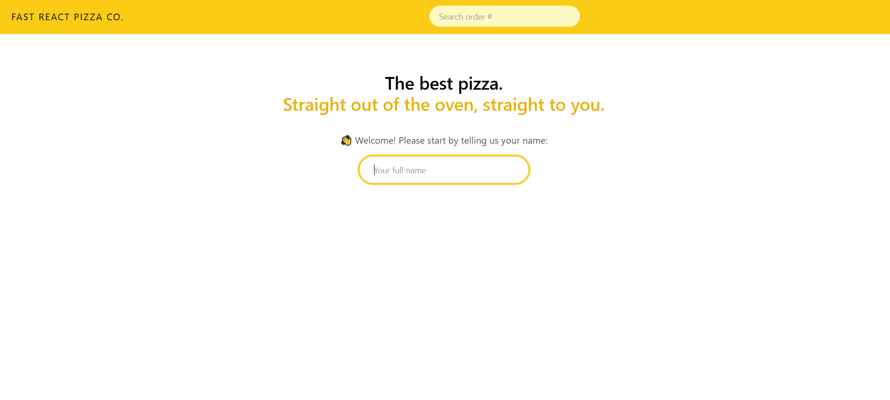
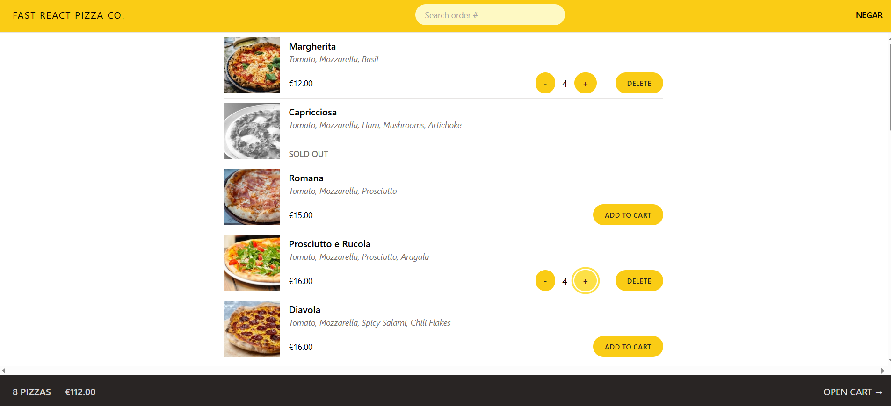
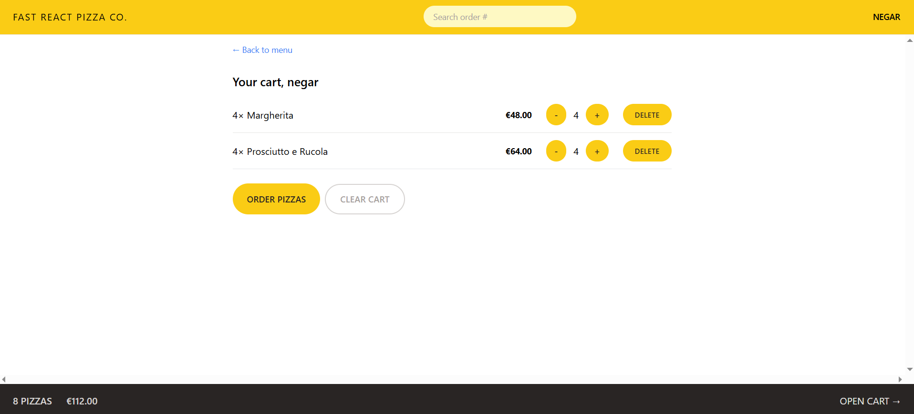
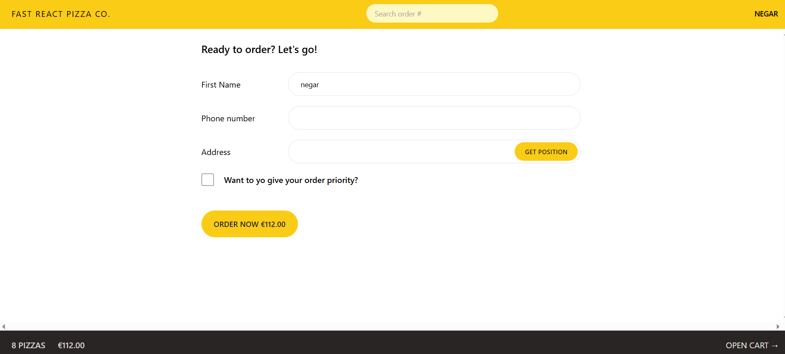
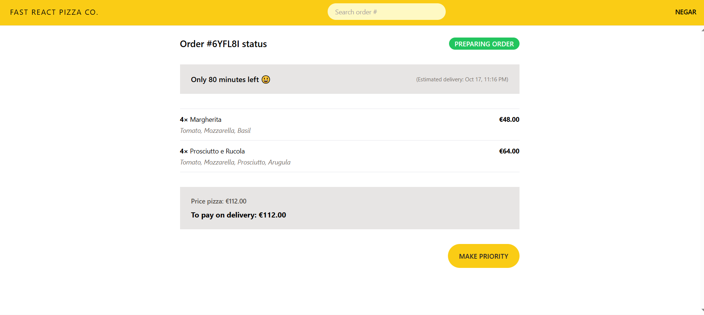

# 🍕 Fast React Pizza

A pizza ordering web application built with React, where users can browse the menu, manage their cart, and place orders.

## 📸 Screenshots

### Welcome Page

Enter your name to get started and access the pizza menu.

### Pizza Menu

Browse available pizzas, check sold-out items, add pizzas to your cart, and adjust quantities.

### Shopping Cart

Review selected pizzas and manage your cart before proceeding to checkout.

### Checkout

Enter your name, phone number, and delivery address. You can also use the location button to retrieve your current location, subject to browser permission and location availability.

### Order Details

View your order information and upgrade to priority delivery, even after placing the order.

## ✨ Features

- Personalized welcome screen
- Pizza menu with availability status
- Add, remove, and update cart quantities
- Shopping cart and order summary
- Checkout form with customer and delivery information
- Current-location retrieval through browser geolocation
- Order creation and order lookup
- Priority delivery option, including after order placement

## 🛠️ Built With

- React
- JavaScript (ES6+)
- React Router
- Redux Toolkit
- Tailwind CSS
- Vite

## ⚠️ Note

The application depends on an external API. If the menu does not load or order requests fail, check your internet connection and try again later. If the API is inaccessible on your network, try a VPN where permitted.
